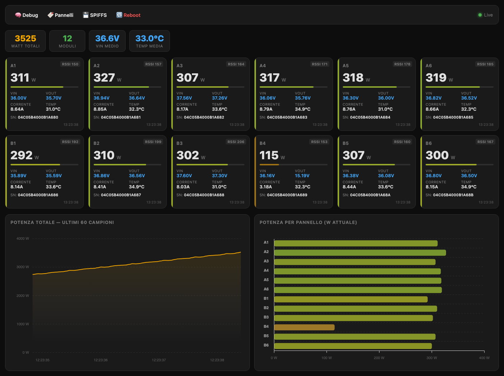
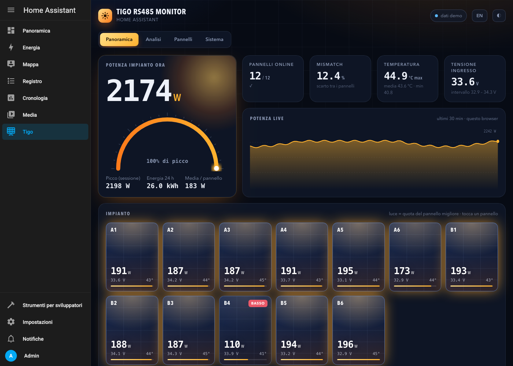

# Tigo RS485 Monitor

[English](README.md) · **Italiano**

Monitor locale per ottimizzatori solari **Tigo TS4**: un ESP32 ascolta il bus RS-485 tra i TAP e il CCA e legge,
per ogni pannello, potenza, tensioni, corrente e temperatura. Nessun cloud, nessuna modifica al CCA: l'ESP32 è in
sola ricezione e il CCA continua a funzionare come prima.

Esistono due varianti dello stesso progetto. Leggono il bus nello stesso modo, con la stessa decodifica verificata sul
firmware del CCA; cambia **dove vedi i dati**.

## Scegli la variante

<table>
<tr>
<th width="50%"><a href="arduino/README.it.md">Arduino · standalone</a></th>
<th width="50%"><a href="esphome/README.it.md">ESPHome · Home Assistant</a></th>
</tr>
<tr>
<td></td>
<td></td>
</tr>
<tr>
<td>La dashboard web dell'ESP32: una scheda per pannello, potenza totale nel tempo e confronto tra pannelli.</td>
<td>Le entità native in Home Assistant, usate in una dashboard: potenza, energia, temperature e storico.</td>
</tr>
</table>

<sub>Esempi con dati inventati: 12 pannelli, B4 in ombra. A sinistra la vera dashboard del firmware, a destra un
mockup di una dashboard Home Assistant costruita con le entità della variante ESPHome.</sub>

### Arduino: un dispositivo autonomo

L'ESP32 è un piccolo server: apri il suo indirizzo nel browser e hai subito la dashboard, senza installare nient'altro.

- **Ideale se** non usi Home Assistant, vuoi guardare l'impianto da un browser, o vuoi uno strumento di diagnosi da
  portare sul campo.
- **Cosa offre**: dashboard live, pagina di debug con i valori grezzi, pagina per dare un nome ai pannelli,
  file manager, WebSocket per altri programmi.
- **Con Home Assistant**: possibile, tramite l'integrazione [tigosolar-local](https://github.com/Bobsilvio/tigosolar-local)
  (sorgente `ESP32_WS`), che legge il WebSocket.
- **Limiti**: lo storico della dashboard dura finché la pagina è aperta (60 campioni in memoria); Wi-Fi e pin si
  impostano nel codice e si compila con l'Arduino IDE.

### ESPHome: dentro Home Assistant

L'ESP32 diventa un dispositivo ESPHome: Home Assistant lo trova da solo e ogni pannello ha le sue entità.

- **Ideale se** usi già Home Assistant e vuoi i dati dei pannelli accanto al resto della casa.
- **Cosa offre**: entità native per potenza, tensioni, corrente, temperatura, RSSI e duty cycle di ogni pannello;
  storico, statistiche a lungo termine, dashboard Energia, automazioni e notifiche (per esempio "B4 produce poco").
  In più una dashboard web sull'ESP32 stesso, con produzione delle ultime 24 ore, classifica dell'energia, mappa di
  calore e analisi automatiche, che l'[add-on](addon/README.it.md) porta nella sidebar di Home Assistant con mesi di
  storico.
- **Configurazione**: poche righe di YAML, i pannelli si trovano da soli (`panels: 12`); aggiornamenti OTA e log da
  ESPHome. Il componente si scarica da questo repository.
- **Limiti**: la dashboard tiene 24 ore in RAM (lo storico lungo è in Home Assistant); i pannelli hanno un nome
  generico (Panel 1, Panel 2, …) da rinominare in Home Assistant, oppure nomi fissi nel YAML.

### Le differenze in breve

| | Arduino | ESPHome |
|---|---|---|
| Dove vedi i dati | dashboard web dell'ESP32 | Home Assistant, più la dashboard web dell'ESP32 |
| Serve Home Assistant | no | sì |
| Storico | solo a pagina aperta | completo in Home Assistant; ultime 24 h nella dashboard |
| Configurazione | Arduino IDE, Wi-Fi e pin nel codice | YAML ESPHome |
| Pannelli nuovi | compaiono da soli | compaiono da soli (posti automatici) |
| Nomi dei pannelli | pagina `/panels` | rinominati in Home Assistant, o fissi nel YAML |
| Pannello che smette di trasmettere | dopo 5 minuti `online: false` e valori a 0 | dopo 5 minuti "non disponibile" |
| Aggiornamenti | OTA Arduino | OTA ESPHome |
| Integrazione custom in HA | sì (tigosolar-local) | no, nativo |

Entrambe identificano i pannelli col long address dell'ottimizzatore, salvano in memoria l'abbinamento con l'ID corto
e il modello hardware, e calcolano potenza e corrente come il CCA.

## Hardware comune

- ESP32
- modulo TTL↔RS485 (MAX485 o ad auto-direzione) in **sola ricezione**: l'uscita dati del modulo va al pin RX
  dell'ESP32, l'ingresso dati del modulo resta scollegato
- collegamento A/B in parallelo al bus TAP ↔ CCA, 38400 baud 8N1
- convertitore DC-DC 12/24 V → 5 V (USB-C) per alimentare l'ESP32 dal bus


## Protocollo

[docs/PROTOCOL-NOTES.md](docs/PROTOCOL-NOTES.md) descrive il protocollo del bus come lo decodifica il firmware del
CCA (4.0.8): layout del power report, scala della corrente per ID hardware, nomi ufficiali dei pacchetti e i punti
in cui [taptap](https://github.com/willglynn/taptap) è sbagliato o incompleto.

## Struttura del repository

```
arduino/    variante Arduino: sketch TigoServer/ e README
esphome/    variante ESPHome: componente tigo_rs485, example.yaml, test, README
addon/      add-on di Home Assistant: la dashboard nella sidebar, storico lungo
docs/       note sul protocollo
images/     immagini
```

## Crediti

- Reverse engineering del protocollo: [willglynn/taptap](https://github.com/willglynn/taptap)
- Progetto originale: [tictactom/tigo_server](https://github.com/tictactom/tigo_server)
- Correzioni al protocollo ricavate dal firmware del CCA: [docs/PROTOCOL-NOTES.md](docs/PROTOCOL-NOTES.md)

## Licenza

MIT — libero adattamento per il proprio impianto.
