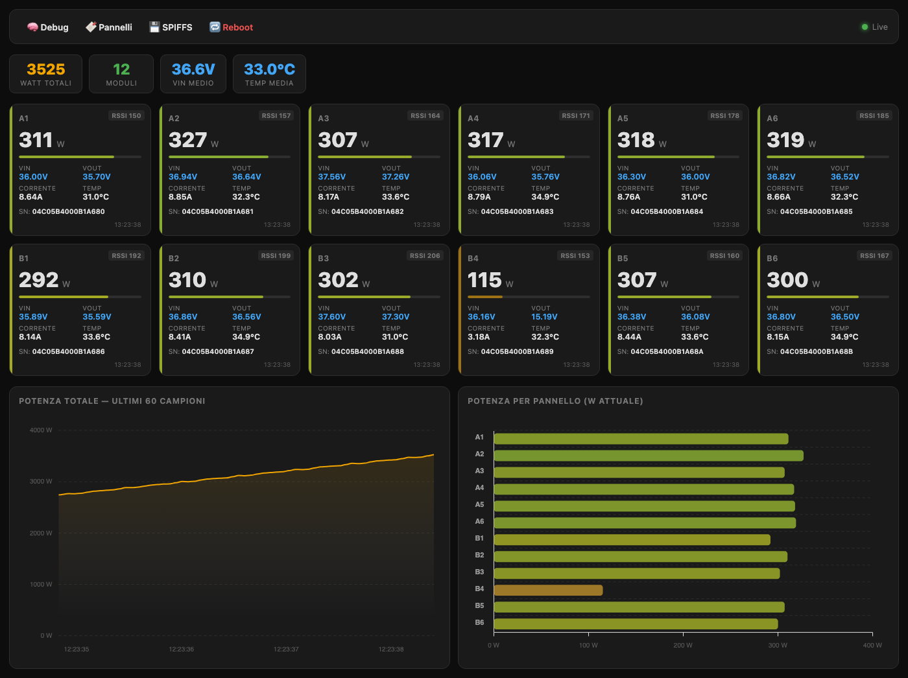
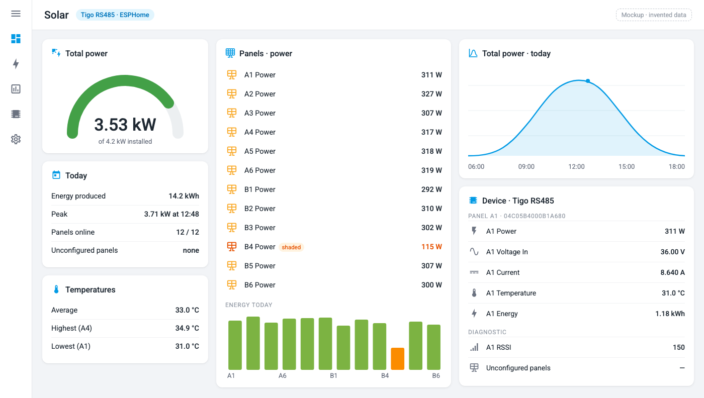

# Tigo RS485 Monitor

**English** · [Italiano](README.it.md)

Local monitor for **Tigo TS4** solar optimizers: an ESP32 listens to the RS-485 bus between the TAPs and the CCA and
reads, for each panel, power, voltages, current and temperature. No cloud, no changes to the CCA: the ESP32 only
receives, and the CCA keeps working as before.

The project comes in two variants. Both read the bus the same way, with the same decoding verified against the CCA
firmware; what changes is **where you see the data**.

## Choose your variant

<table>
<tr>
<th width="50%"><a href="arduino/README.md">Arduino · standalone</a></th>
<th width="50%"><a href="esphome/README.md">ESPHome · Home Assistant</a></th>
</tr>
<tr>
<td></td>
<td></td>
</tr>
<tr>
<td>The ESP32's own web dashboard: one card per panel, total power over time and a panel comparison.</td>
<td>Native Home Assistant entities, used in a dashboard: power, energy, temperatures and history.</td>
</tr>
</table>

<sub>Examples with invented data: 12 panels, B4 shaded. Left: the real firmware dashboard (its interface is in
Italian). Right: a mockup of a Home Assistant dashboard built from the ESPHome variant's entities.</sub>

### Arduino: a standalone device

The ESP32 is a small server: open its address in a browser and the dashboard is there, nothing else to install.

- **Best if** you don't use Home Assistant, you want to watch the system from a browser, or you want a diagnostic
  tool to take on site.
- **What you get**: live dashboard, debug page with raw values, a page to name the panels, file manager, and a
  WebSocket for other programs.
- **With Home Assistant**: possible, through the [tigosolar-local](https://github.com/Bobsilvio/tigosolar-local)
  integration (`ESP32_WS` source), which reads the WebSocket.
- **Limits**: the dashboard history lasts only while the page is open (60 samples in memory); Wi-Fi and pins are
  set in the code, built with the Arduino IDE.

### ESPHome: inside Home Assistant

The ESP32 becomes an ESPHome device: Home Assistant discovers it and every panel gets its own entities.

- **Best if** you already use Home Assistant and want the panel data next to the rest of your home.
- **What you get**: native entities for each panel's power, voltages, current, temperature, RSSI and duty cycle;
  history, long-term statistics, the Energy dashboard, automations and notifications (e.g. "B4 is producing little").
  Plus a web dashboard on the ESP32 itself, with 24-hour production, energy ranking, heatmap and automatic insights.
- **Setup**: a few lines of YAML, panels are found by themselves (`panels: 12`); OTA updates and logs from ESPHome.
  The component is downloaded from this repository.
- **Limits**: the dashboard keeps 24 hours in RAM (long-term history is in Home Assistant); panels get a generic
  name (Panel 1, Panel 2, …) to rename in Home Assistant, or fixed names in the YAML.

### Differences at a glance

| | Arduino | ESPHome |
|---|---|---|
| Where you see the data | the ESP32's web dashboard | Home Assistant, plus the ESP32's web dashboard |
| Needs Home Assistant | no | yes |
| History | only while the page is open | full in Home Assistant; last 24 h on the dashboard |
| Setup | Arduino IDE, Wi-Fi and pins in the code | ESPHome YAML |
| New panels | appear by themselves | appear by themselves (automatic slots) |
| Panel names | `/panels` page | renamed in Home Assistant, or fixed in the YAML |
| Panel that stops reporting | after 5 minutes `online: false` and values at 0 | after 5 minutes "unavailable" |
| Updates | Arduino OTA | ESPHome OTA |
| Custom integration in HA | yes (tigosolar-local) | no, native |

Both identify panels by the optimizer's long address, keep its mapping to the short node ID and the hardware model
in memory, and compute power and current the way the CCA does.

## Common hardware

- ESP32
- TTL↔RS485 module (MAX485 or auto-direction) in **receive-only** mode: the module's data output goes to the
  ESP32 RX pin, the module's data input stays disconnected
- A/B wired in parallel to the TAP ↔ CCA bus, 38400 baud 8N1
- 12/24 V → 5 V DC-DC converter (USB-C) to power the ESP32 from the bus


## Protocol

[docs/PROTOCOL-NOTES.md](docs/PROTOCOL-NOTES.md) describes the bus protocol as the CCA firmware (4.0.8) decodes it:
power report layout, current scale by hardware ID, official packet names, and where
[taptap](https://github.com/willglynn/taptap) is wrong or incomplete.

## Repository layout

```
arduino/    Arduino variant: TigoServer/ sketch and README
esphome/    ESPHome variant: tigo_rs485 component, example.yaml, tests, README
docs/       protocol notes
images/     images
```

## Credits

- Protocol reverse engineering: [willglynn/taptap](https://github.com/willglynn/taptap)
- Original project: [tictactom/tigo_server](https://github.com/tictactom/tigo_server)
- Protocol corrections from the CCA firmware: [docs/PROTOCOL-NOTES.md](docs/PROTOCOL-NOTES.md)

## License

MIT — free to adapt for your own system.
