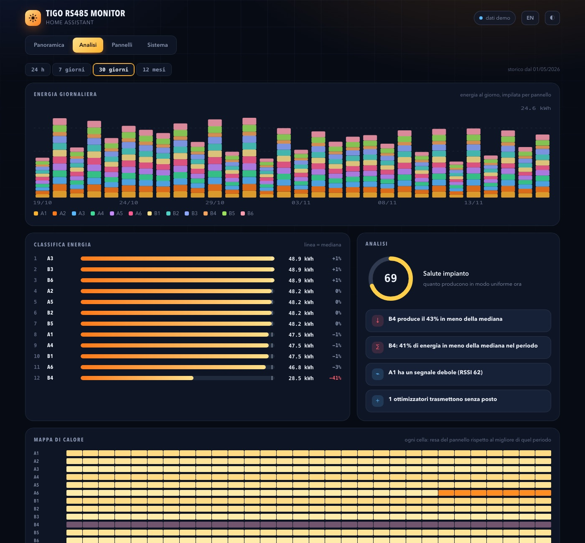

# Tigo RS485 Monitor – add-on di Home Assistant

[English](README.md) · **Italiano**

La dashboard della [variante ESPHome](../esphome/README.it.md) nella sidebar di Home Assistant, con mesi di storico
dell'energia per pannello.

Screenshot con dati inventati: B4 in ombra, A6 che perde resa nell'ultima settimana.

## Installazione

1. Home Assistant → **Impostazioni** → **Componenti aggiuntivi** → **Raccolta di componenti aggiuntivi** → ⋮ →
   **Repository**, aggiungi `https://github.com/Bobsilvio/tigo_server`.
2. Installa **Tigo RS485 Monitor**.
3. In **Configurazione** imposta `host` con l'indirizzo IP dell'ESP32 (e `username`/`password` se `web_server` ha
   `auth:`).
4. Avvialo e apri **Tigo** nella sidebar.

L'ESP32 deve avere il componente `tigo_rs485` con `web_server:` attivo.

## Opzioni

| Opzione | Descrizione |
|---|---|
| `host` | indirizzo IP dell'ESP32, ad esempio `192.168.1.50`. Un nome `.local` può non risolversi dentro l'add-on: meglio l'IP (con una prenotazione DHCP per l'ESP32). |
| `port` | porta del `web_server` ESPHome, `80` di default |
| `username` / `password` | solo se `web_server` ha `auth:` |
| `retention_days` | quanti giorni di energia oraria conservare (predefinito 730) |

## Cosa aggiunge alla pagina dell'ESP32

| | Pagina ESP32 | Add-on |
|---|---|---|
| Dove | `http://<esp32>/`, rete locale | sidebar di Home Assistant, anche da remoto e nell'app |
| Storico | ultime 24 h, perse al riavvio | 7 giorni, 30 giorni, 12 mesi, conservati per `retention_days` |
| Analisi | live e 24 h | anche energia giornaliera/mensile, classifica e mappa di calore relativa sul periodo |

## Come registra lo storico

L'ESP32 integra la potenza di ogni pannello a ogni report del bus ed espone l'energia dall'avvio. L'add-on la legge
ogni 30 secondi e salva gli incrementi ora per ora, quindi il risultato non dipende dalla frequenza di lettura. Un
riavvio dell'ESP32 o l'azzeramento dei posti vengono riconosciuti e non fanno perdere energia.

Lo storico parte dall'installazione dell'add-on. Mentre l'add-on è fermo non si registra nulla: dopo un'interruzione
di più di due ore l'energia prodotta nel frattempo non viene attribuita all'ora della ripartenza. I pannelli sono
identificati dal long address, quindi rinominare le entità o spostare i posti non spezza lo storico.

Il database sta nella cartella dati dell'add-on ed è incluso nei backup di Home Assistant.

## Sviluppo

`server.py` usa solo la libreria standard di Python. La dashboard è una copia di
`esphome/components/tigo_rs485/dashboard/index.html`: dopo averla modificata esegui `./sync-dashboard.sh`.
