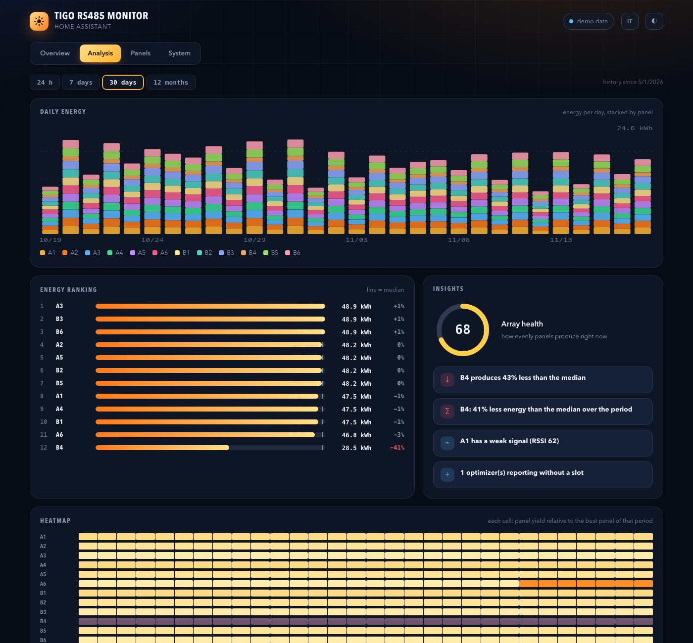

# Tigo RS485 Monitor – Home Assistant add-on

**English** · [Italiano](README.it.md)

The dashboard of the [ESPHome variant](../esphome/README.md) in the Home Assistant sidebar, with the energy history
of each panel taken from what Home Assistant already records.

Screenshot with invented data: B4 shaded, A6 losing yield in the last week.

## Install

1. Home Assistant → **Settings** → **Add-ons** → **Add-on store** → ⋮ → **Repositories**, add
   `https://github.com/Bobsilvio/tigo_server`.
2. Install **Tigo RS485 Monitor**.
3. In **Configuration** set `host` to the ESP32 IP address (and `username`/`password` if `web_server` has `auth:`).
4. Start it and open **Tigo** in the sidebar.

The ESP32 must run the `tigo_rs485` component with `web_server:` enabled. The history comes from the long-term
statistics of the panel power sensors: the add-on stores nothing. Details: [DOCS.md](DOCS.md).

## What it adds to the ESP32 page

| | ESP32 page | Add-on |
|---|---|---|
| Where | `http://<esp32>/`, local network | Home Assistant sidebar, also remote and in the app |
| History | last 24 h, lost at reboot | 7 days, 30 days, 12 months, from the Home Assistant statistics |
| Analysis | live and 24 h | also daily/monthly energy, ranking and relative heatmap over the period |

## Development

`server.py` uses only the Python standard library. The dashboard is a copy of
`esphome/components/tigo_rs485/dashboard/index.html`: after changing it run `./sync-dashboard.sh`.
