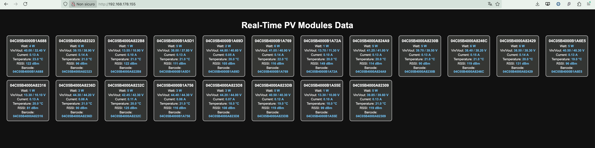
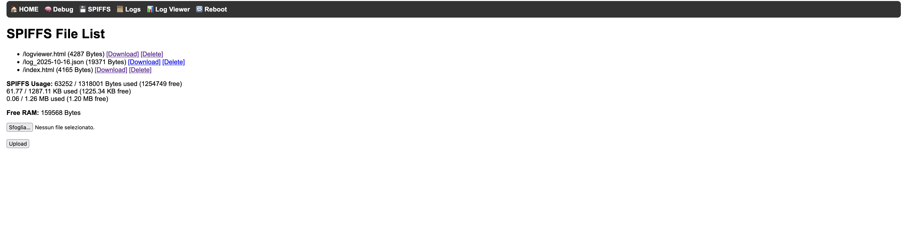

# Tigo RS485 Monitor – Arduino (standalone)

**English** · [Italiano](README.it.md)

**Standalone** variant of [Tigo RS485 Monitor](../README.md): Arduino firmware for the ESP32 that reads the RS-485 bus
between the TAPs and the CCA and provides its own web dashboard, a WebSocket and SPIFFS persistence. No Home
Assistant required.

To use it with Home Assistant: the [tigosolar-local](https://github.com/Bobsilvio/tigosolar-local) integration,
`ESP32_WS` source (reads the WebSocket). If you only want Home Assistant, consider the [ESPHome](../esphome/README.md)
variant.




The web interface is in Italian.

---

## 🛠️ Hardware

| Component | Notes |
|---|---|
| **ESP32 / ESP32-S3** | At least 4 MB flash with a SPIFFS partition |
| **TTL→RS485 converter** | MAX485 or similar |
| **5 V regulator** | When powered from the RS-485 bus |

---

## ⚙️ Features

- 📡 **RS-485 bus reading** (Tigo TAP/CCA, 38400 baud 8N1)
- 🔍 **Frame parsing**: power (0x31), topology (0x09), node table (0x27), `Version` string (0x07, for the hardware ID)
- 📖 **Protocol verified against the CCA firmware**: decoding matches CCA 4.0.8; details and corrections to taptap in [docs/PROTOCOL-NOTES.md](../docs/PROTOCOL-NOTES.md)
- 🌐 **Built-in web server**:
  - `/` – Live dashboard with charts (ApexCharts) and one card per module
  - `/debug` – Raw table (voltage, current, temperature, RSSI, …)
  - `/panels` – Manual long address → label mapping (e.g. A4)
  - `/spiffs` – File manager (upload / download / delete SPIFFS files)
- 🔌 **WebSocket `/ws`** — real-time updates; payload per module:
  ```json
  {
    "id":       "A4",
    "panel":    "A4",
    "longaddr": "04C05B4000B1A688",
    "barcode":  "04C05B4000B1A688",
    "addr":     "001A",
    "watt":     250,
    "vin":      34.70,
    "vout":     34.40,
    "amp":      6.94,
    "temp":     34.4,
    "rssi":     126,
    "online":   true,
    "age":      3,
    "hwid":     45
  }
  ```
  `watt` = `vin` × `amp` (optimizer input power). `rssi` is the raw 0–255 value, not dBm.
  `hwid` = module hardware ID read from the `Version` answer (e.g. `Mnode Version K8.0120 (2D)` → 0x2D), `-1` until seen.
  The current scale depends on `hwid` as in the CCA: ≤ 0x23 → 0.0025 A; 0x24–0x5F → 0.005 A; > 0x5F → 0.025 A
  (0.005 A without `hwid`). `temp` is updated only when bit 0x20 of the status word marks it as a temperature.
  When a module sends nothing for 5 minutes: `online: false` and `watt`/`vin`/`vout`/`amp` at 0. `age` = seconds since the last data (`-1` = never received).
- 💾 **Node table** — automatic save with a 30 s debounce (`/nodetable.json`, includes each module's `hwid`)
- 🔖 **Panel map** — persistent long address → label mapping (`/panel_map.json`)
- 🕒 **NTP sync** — accurate time once synced; without internet, boot continues after 10 s
- 🧵 **Safe concurrent access** — data shared between RS-485 decoding and the web pages is protected by a mutex; 4 KB RS-485 receive buffer
- 🔁 **OTA** — firmware updates over the network
- 📊 **Graphical dashboard**:
  - Area chart — total power over time (last 60 samples, in memory)
  - Horizontal bar chart — instant power per panel, coloured by watts
  - One card per module with progress bar, Vin/Vout, current, temperature, RSSI

---

## 📂 SPIFFS files

| File | Description |
|---|---|
| `index.html` | Web dashboard |
| `nodetable.json` | Short addr ↔ long address mapping (generated automatically) |
| `panel_map.json` | Long address ↔ panel label mapping (managed from `/panels`) |

---

## 🔖 Panel mapping

Go to `/panels`: each row shows a module's long address (e.g. `04C05B4000B1A688`).
Type the label (e.g. `A4`) and click **Salva** (Save).
From then on the WebSocket sends `"panel": "A4"` and `"id": "A4"` for that module.
The long address is always available in the `barcode` and `longaddr` fields.

---

## 🔄 Automatic node table save

`loop()` checks on every pass: if `NodeTable_changed == true` and at least 30 s have passed
since the last save → it calls `saveNodeTable()` and clears the flag.
A manual save is available on `/debug` → **Salva NodeTable ora** button.

---

## 🧰 Installation (Arduino IDE)

### 1. Prerequisites
- **Arduino IDE 2.x**
- ESP32 board support:
  *File → Preferences → Additional boards manager URLs*:
  ```
  https://espressif.github.io/arduino-esp32/package_esp32_index.json
  ```
  Then: *Tools → Board → Boards Manager → "esp32" → Install*

### 2. Required libraries
Install via *Sketch → Include Library → Manage Libraries*:
- **ArduinoJson** (Benoit Blanchon) — version 6 or 7
- **ESPAsyncWebServer** + **AsyncTCP**
- **PubSubClient** (MQTT)
- **WebSerial**

### 3. Board settings
*Tools*:
- **Board:** `ESP32 Dev Module` (or an S3 variant)
- **Partition Scheme:** `No OTA (1MB APP / 3MB SPIFFS)`
- **Upload Speed:** 921600

### 4. Open the sketch, Wi-Fi and pins
Open `arduino/TigoServer/TigoServer.ino` (the sketch folder must be named `TigoServer`; the `data/` folder next to
it holds the SPIFFS files). At the top of the file:
```cpp
const char* ssid     = "YourWiFi";
const char* password = "YourPassword";
#define RX_PIN 3  // pin wired to the RS-485 converter's data output
#define TX_PIN 1
```
Set `RX_PIN`/`TX_PIN` to the pins you wired. The default in the code is 3/1, the same pins as the USB serial port.

### 5. Flash the firmware
1. Connect the ESP32 over USB
2. Click **→ Upload**
3. Open the *Serial Monitor* (115200 baud)

### 6. Upload the SPIFFS files
Install the **ESP32 Sketch Data Upload** plugin:
→ [https://github.com/me-no-dev/arduino-esp32fs-plugin](https://github.com/me-no-dev/arduino-esp32fs-plugin)
Then: *Tools → ESP32 Sketch Data Upload*

### 7. First access
Find the IP in the Serial Monitor or in your router's DHCP list:
```
http://<ESP32_IP>
```
- `/` — Dashboard + charts
- `/debug` — Raw data + node table
- `/panels` — Label mapping
- `/spiffs` — File manager

---

## ⚡ Wiring


| RS-485 module | ESP32 / bus | Notes |
|---|---|---|
| VCC | 3V3 | |
| GND | GND | |
| TXD | `RX_PIN` (default GPIO 3) | data from the bus to the ESP32 |
| RXD | not connected | the monitor never transmits |
| A (D+) / B (D−) | A / B of the TAP ↔ CCA bus | in parallel |

The ESP32 is powered over USB-C by a 12/24 V → 5 V DC-DC converter connected to +V/GND of the bus.

---

Credits and license: see the [main README](../README.md).
