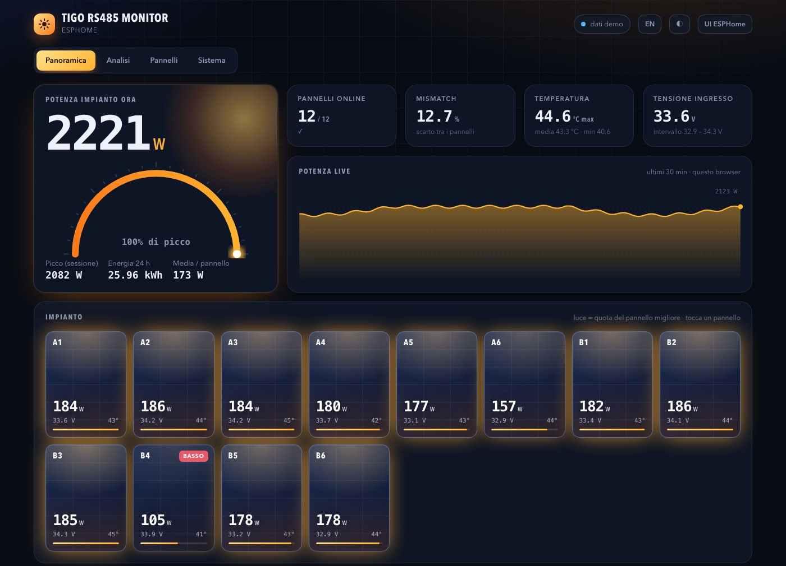
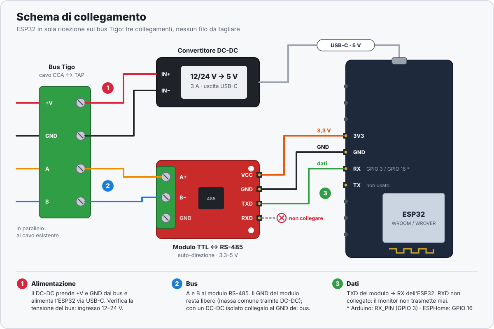
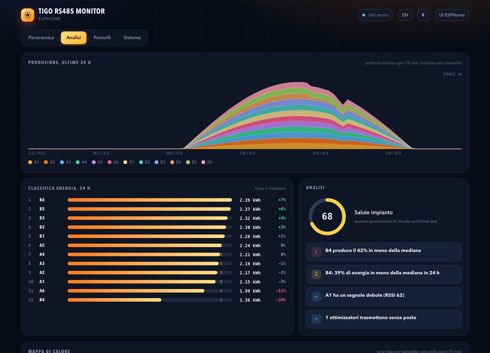

# Tigo RS485 Monitor – ESPHome (Home Assistant)

[English](README.md) · **Italiano**

Variante **ESPHome** di [Tigo RS485 Monitor](../README.it.md): un componente esterno ESPHome (`tigo_rs485`) che ascolta
il bus RS-485 tra TAP e CCA e pubblica in Home Assistant, in modo nativo, un set di sensori per ogni ottimizzatore.
I pannelli vengono riconosciuti da soli appena trasmettono, e l'ESP32 serve anche una propria dashboard web con dati
live e analisi. Niente integrazione custom, niente WebSocket: Wi-Fi, OTA e log sono quelli standard di ESPHome.

Per un dispositivo autonomo senza Home Assistant usa la variante [Arduino](../arduino/README.it.md).



---

## Cosa fa

- Ascolta il bus in **sola ricezione** (38400 baud 8N1): non trasmette mai, il CCA continua a funzionare come prima.
- **Trova i pannelli da solo**: con `panels: 12` il dispositivo riserva 12 posti e assegna a ogni ottimizzatore il
  primo libero appena ne conosce il long address. Nessun indirizzo da copiare, nessun elenco da scrivere.
- Per ogni pannello pubblica **potenza**, tensione d'ingresso e d'uscita, **corrente**, **temperatura**, RSSI e duty
  cycle, più il long address.
- Serve una **dashboard web** all'indirizzo del dispositivo: mappa dell'impianto live, produzione delle ultime 24 ore,
  classifica dell'energia, mappa di calore, analisi automatiche (pannelli che rendono poco, caldi o offline), tabella
  con esportazione CSV.
- Decodifica allineata al firmware del CCA (4.0.8), più accurata di taptap:
  - potenza = Vin × Iin, come la calcola il CCA;
  - scala della corrente secondo l'ID hardware del modulo (letto dalle risposte `Version`):
    ≤ 0x23 → 0,0025 A, 0x24–0x5F → 0,005 A, > 0x5F → 0,025 A; 0,005 A finché non è noto;
  - temperatura pubblicata solo quando il bit 0x20 della status word la marca come tale;
  - RSSI 0 ("valore non valido") scartato.

  Dettagli: [docs/PROTOCOL-NOTES.md](../docs/PROTOCOL-NOTES.md).
- Identifica i pannelli per **long address** (64 bit, fisso nell'hardware), non per l'ID corto che il CCA può
  riassegnare. L'abbinamento ID corto → long address, l'ID hardware e le assegnazioni dei posti sono salvati in flash
  e sopravvivono ai riavvii.
- Un pannello che non trasmette per `offline_timeout` (predefinito 5 minuti) diventa "non disponibile" in Home Assistant.

---

## Hardware



| Componente | Note |
|---|---|
| **ESP32** | qualsiasi modulo supportato da ESPHome |
| **Convertitore TTL→RS485** | MAX485 o simile, in sola ricezione |
| **Regolatore 5 V** | se alimentato dal bus |

| Modulo RS-485 | ESP32 / bus | Note |
|---|---|---|
| VCC | 3V3 | |
| GND | GND | |
| TXD (o RO) | `rx_pin` (es. GPIO 16) | dati dal bus verso l'ESP32 |
| RXD (o DI) | non collegato | l'ESP32 non trasmette |
| RE/DE (se presenti) | GND | sola ricezione; i moduli ad auto-direzione non li hanno |
| A (D+) / B (D−) | A / B del bus TAP ↔ CCA | in parallelo |

Evita i pin della seriale USB (GPIO 1/3 su ESP32): il logger di ESPHome li usa.

---

## Installazione

Il componente si aggiunge a un dispositivo ESPHome: poche righe nel YAML del dispositivo, non c'è un file da copiare.

### 1. Crea il dispositivo ESPHome

Nella dashboard ESPHome (add-on di Home Assistant o standalone): **+ New device** → ESP32, poi la prima
installazione via USB. Il YAML del dispositivo contiene già `esphome:`, `esp32:`, `wifi:`, `api:` e `ota:`: lasciali
come sono. Se hai già un ESP32 in ESPHome usa quello e salta questo passo.

### 2. Aggiungi il componente

Apri il YAML del dispositivo (**Edit**) e aggiungi in fondo queste righe:

```yaml
external_components:
  - source: github://Bobsilvio/tigo_server@main
    components: [tigo_rs485]

uart:
  id: tigo_bus
  rx_pin: GPIO16          # pin collegato al TXD del modulo
  baud_rate: 38400
  rx_buffer_size: 2048

tigo_rs485:
  uart_id: tigo_bus
  panels: 12              # almeno quanti sono i tuoi ottimizzatori

web_server:               # opzionale: la dashboard web
  port: 80
```

Imposta `panels:` al numero di ottimizzatori, o poco di più: i posti non usati restano vuoti.

> Se il YAML ha già una sezione `web_server:` non aggiungerne una seconda: la dashboard usa quella esistente.

### 3. Installa

**Save** → **Install** → **Wirelessly**. Quando c'è sole gli ottimizzatori iniziano a trasmettere e riempiono i
posti: in Home Assistant il dispositivo mostra `Panel 1 Power`, `Panel 1 Voltage In`, …, `Panel 1 Address` e così via.
Apri `http://<indirizzo del dispositivo>/` per la dashboard.

### 4. Dai un nome ai pannelli

I posti si riempiono nell'ordine in cui i pannelli trasmettono, non secondo la disposizione sul tetto. Per capire
quale è quale:

- guarda l'entità **Address** di ogni posto (o il dettaglio del pannello nella dashboard) e confrontala con gli ID
  degli ottimizzatori che conosci dall'app Tigo o dall'installatore;
- oppure copri o ombreggia un pannello per un minuto e guarda quale posto scende.

Poi rinomina le entità in Home Assistant (Panel 3 → B4): il nome resta, perché l'entità è legata al posto e il posto
all'ottimizzatore.

Per ricominciare (ottimizzatori nuovi, ordine sbagliato) premi **Reset panel assignments** in Home Assistant o nella
dashboard (tab Sistema): i posti vengono liberati e si riempiono di nuovo man mano che i pannelli trasmettono.

---

## Dashboard web

Quando il dispositivo ha anche `web_server:`, il componente serve una propria pagina su `/`. È autonoma (non serve
internet) e funziona da telefono e da computer, in italiano o in inglese, con tema scuro o chiaro.

| Tab | Contenuto |
|---|---|
| **Panoramica** | potenza totale con indicatore, pannelli online, mismatch tra pannelli, temperatura, tensione d'ingresso, grafico live, mappa dell'impianto con ogni pannello illuminato in proporzione al migliore |
| **Analisi** | produzione impilata delle ultime 24 h, classifica dell'energia rispetto alla mediana, punteggio di salute dell'impianto, analisi automatiche, mappa di calore pannello × ora |
| **Pannelli** | tabella ordinabile con tutti i valori, scarto dalla mediana, esportazione CSV |
| **Sistema** | ottimizzatori non configurati con indirizzo da copiare, uso dei posti, azzeramento delle assegnazioni |



<sub>Screenshot con dati inventati: 12 pannelli, B4 in ombra nel pomeriggio.</sub>

- Lo storico di 24 ore (intervalli di 15 minuti) è tenuto nella RAM dell'ESP32: riparte dopo un riavvio. Per lo
  storico lungo usa Home Assistant.
- La pagina standard di ESPHome resta su `/?esphome` (pulsante **UI ESPHome** in alto).
- JSON per altri programmi: `/tigo/live` (valori attuali) e `/tigo/history` (Wh per pannello, 96 intervalli).
- Se `web_server` ha `auth:`, dashboard ed endpoint JSON chiedono le stesse credenziali.
- `web_dashboard: false` lascia su `/` la pagina standard di ESPHome.

### Nella sidebar di Home Assistant

L'[add-on](../addon/README.it.md) mette la stessa dashboard nella sidebar di Home Assistant, raggiungibile da remoto
e nell'app, e registra l'energia di ogni pannello ora per ora: il tab Analisi guadagna 7 giorni, 30 giorni e 12 mesi.

---

## Nomi fissi nel YAML (opzionale)

Al posto dei posti automatici, o insieme a loro, un pannello si può dichiarare con il suo long address e i nomi che
vuoi. Un pannello dichiarato così non occupa un posto.

```yaml
sensor:
  - platform: tigo_rs485
    long_address: "04C05B4000B1A688"
    power:
      name: A1 Power
    voltage_in:
      name: A1 Voltage In
    temperature:
      name: A1 Temperature
```

L'indirizzo lo mostrano l'entità **Address** del posto, la dashboard o il sensore dei pannelli non configurati:

```yaml
text_sensor:
  - platform: tigo_rs485
    unconfigured_panels:
      name: Unconfigured panels
```

> Se il YAML ha già una sezione `sensor:` o `text_sensor:`, aggiungi sotto solo la voce `- platform: tigo_rs485`: una
> sezione non può comparire due volte.

Il long address di un modulo si impara quando il CCA rilegge la tabella dei nodi, cosa che succede di rado (di
solito alla discovery). Finché non è noto il pannello compare come `node 001A` tra quelli non configurati e non prende
un posto; puoi dichiararlo temporaneamente con l'ID corto, sapendo che il CCA può riassegnarlo:

```yaml
  - platform: tigo_rs485
    node_id: 0x001A
    power:
      name: A3 Power
```

### Energia per la dashboard Energia

Dai un `id` al sensore di potenza e integralo sul dispositivo:

```yaml
sensor:
  - platform: tigo_rs485
    long_address: "04C05B4000B1A688"
    power:
      name: A1 Power
      id: a1_power

  - platform: integration
    name: A1 Energy
    sensor: a1_power
    time_unit: h
    unit_of_measurement: Wh
    device_class: energy
    state_class: total_increasing
    restore: true
```

Con i posti automatici si ottiene lo stesso in Home Assistant con l'helper **Integrale** su `Panel N Power`.

[`example.yaml`](example.yaml) è una configurazione completa: usala come riferimento per controllare la tua, non come
file da copiare.

---

## Riferimento configurazione

**`tigo_rs485`**

| Opzione | Predefinito | Descrizione |
|---|---|---|
| `uart_id` | — | UART collegata al bus (38400 baud) |
| `panels` | `0` | posti automatici (0–64); ognuno ha i suoi sensori e un sensore di testo con l'indirizzo, più un pulsante di reset |
| `panel_sensors` | tutti | sensori creati per ogni posto: `power`, `voltage_in`, `voltage_out`, `current`, `temperature`, `rssi`, `duty_cycle` |
| `panel_name` | `Panel {}` | nome dei posti, `{}` è il numero: ad esempio `Pannello {}` |
| `web_dashboard` | `true` | serve la dashboard su `/` quando `web_server` è configurato |
| `offline_timeout` | `5min` | dopo quanto un pannello silenzioso diventa non disponibile |

**`sensor` / `platform: tigo_rs485`** — esattamente uno tra `long_address` (16 cifre esadecimali) e `node_id`,
più uno o più tra `power` (W), `voltage_in` (V), `voltage_out` (V), `current` (A), `temperature` (°C),
`rssi` (valore grezzo 0–255, non dBm), `duty_cycle` (%).

**`text_sensor` / `platform: tigo_rs485`** — `unconfigured_panels`: pannelli che trasmettono senza posto né voce nel YAML.

---

## Sviluppo

Il decoder del protocollo (`components/tigo_rs485/tigo_protocol.*`) non dipende da ESPHome e si prova sull'host:

```bash
c++ -std=c++17 -I esphome/components/tigo_rs485 esphome/tests/host_test.cpp esphome/components/tigo_rs485/tigo_protocol.cpp -o host_test
```

```bash
./host_test issue_20_initial.bin
```

Senza argomenti esegue i test sintetici; con una cattura del bus (ad esempio `src/test_data/issue_20_initial.bin` di
[taptap](https://github.com/willglynn/taptap)) stampa ogni power report.

La dashboard è `components/tigo_rs485/dashboard/index.html`, incorporata compressa nel firmware. Aperta in locale con
`?demo` (o da `file://`) gira su dati inventati; `?lang=it|en` e `?tab=ov|an|pn|sy` scelgono lingua e tab.
