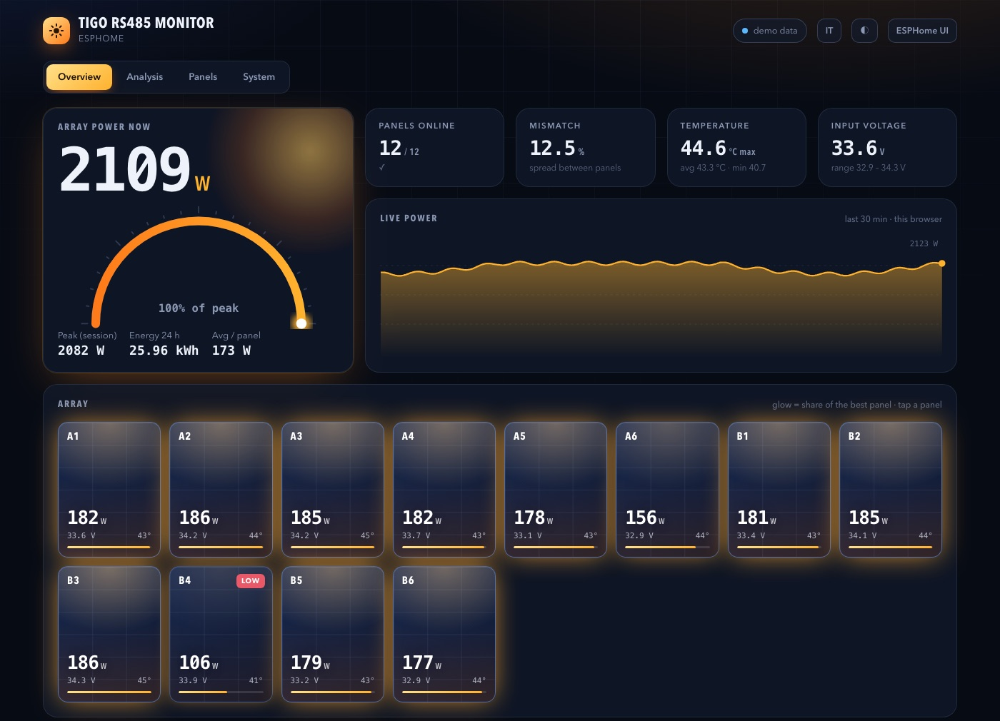
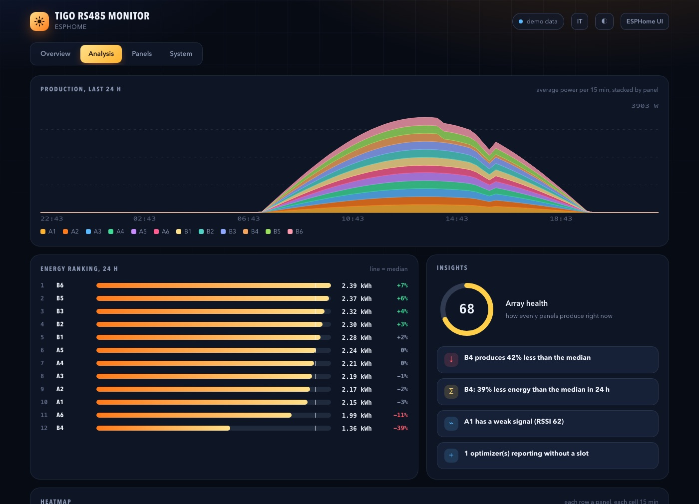

# Tigo RS485 Monitor – ESPHome (Home Assistant)

**English** · [Italiano](README.it.md)

**ESPHome** variant of [Tigo RS485 Monitor](../README.md): an ESPHome external component (`tigo_rs485`) that listens to
the RS-485 bus between the TAPs and the CCA and publishes a set of sensors for each optimizer natively in Home
Assistant. Panels are picked up by themselves as soon as they report, and the ESP32 also serves its own web dashboard
with live data and analysis. No custom integration, no WebSocket: Wi-Fi, OTA and logs are ESPHome's standard ones.

For a standalone device without Home Assistant, use the [Arduino](../arduino/README.md) variant.



---

## What it does

- Listens to the bus **receive-only** (38400 baud 8N1): it never transmits, and the CCA keeps working as before.
- **Finds the panels by itself**: with `panels: 12` the device reserves 12 slots and gives each optimizer the first free
  one as soon as its long address is known. No address to copy, no list to write.
- For each panel it publishes **power**, input and output voltage, **current**, **temperature**, RSSI and duty cycle,
  plus the long address.
- Serves a **web dashboard** at the device address: live array map, 24-hour production, energy ranking, heatmap,
  automatic insights (underperforming, hot or offline panels), table with CSV export.
- Decoding matches the CCA firmware (4.0.8), more accurate than taptap:
  - power = Vin × Iin, as the CCA computes it;
  - current scale by the module hardware ID (read from the `Version` answers):
    ≤ 0x23 → 0.0025 A, 0x24–0x5F → 0.005 A, > 0x5F → 0.025 A; 0.005 A until known;
  - temperature published only when bit 0x20 of the status word marks it as such;
  - RSSI 0 ("no usable value") discarded.

  Details: [docs/PROTOCOL-NOTES.md](../docs/PROTOCOL-NOTES.md).
- Identifies panels by their **long address** (64 bits, fixed in hardware), not by the short ID the CCA can
  reassign. The short ID → long address mapping, the hardware ID and the slot assignments are saved to flash and
  survive reboots.
- A panel that stops reporting for `offline_timeout` (5 minutes by default) becomes "unavailable" in Home Assistant.

---

## Hardware


| Component | Notes |
|---|---|
| **ESP32** | any module supported by ESPHome |
| **TTL→RS485 converter** | MAX485 or similar, receive-only |
| **5 V regulator** | when powered from the bus |

| RS-485 module | ESP32 / bus | Notes |
|---|---|---|
| VCC | 3V3 | |
| GND | GND | |
| TXD (or RO) | `rx_pin` (e.g. GPIO 16) | data from the bus to the ESP32 |
| RXD (or DI) | not connected | the ESP32 never transmits |
| RE/DE (if present) | GND | receive-only; auto-direction modules don't have them |
| A (D+) / B (D−) | A / B of the TAP ↔ CCA bus | in parallel |

Avoid the USB serial pins (GPIO 1/3 on the ESP32): the ESPHome logger uses them.

---

## Installation

The component is added to an ESPHome device: a handful of lines in your device's YAML, there is no file to copy.

### 1. Create the ESPHome device

In the ESPHome dashboard (Home Assistant add-on or standalone): **+ New device** → ESP32, then the first install
over USB. The device YAML already contains `esphome:`, `esp32:`, `wifi:`, `api:` and `ota:`: leave them as they are.
If you already have an ESP32 in ESPHome, use that one and skip this step.

### 2. Add the component

Open the device YAML (**Edit**) and add these lines at the end:

```yaml
external_components:
  - source: github://Bobsilvio/tigo_server@main
    components: [tigo_rs485]

uart:
  id: tigo_bus
  rx_pin: GPIO16          # pin wired to the module's TXD
  baud_rate: 38400
  rx_buffer_size: 2048

tigo_rs485:
  uart_id: tigo_bus
  panels: 12              # at least as many as your optimizers

web_server:               # optional: the web dashboard
  port: 80
```

Set `panels:` to the number of optimizers, or a little more: unused slots stay empty.

> If the YAML already has a `web_server:` section, don't add a second one: the dashboard uses the existing one.

### 3. Install

**Save** → **Install** → **Wirelessly**. When the sun is up the optimizers start reporting and fill the slots:
in Home Assistant the device shows `Panel 1 Power`, `Panel 1 Voltage In`, …, `Panel 1 Address`, and so on.
Open `http://<device address>/` for the dashboard.

### 4. Name the panels

Slots are filled in the order panels report, not following the layout on the roof. To tell which is which:

- look at the **Address** entity of each slot (or the panel detail on the dashboard) and compare it with the optimizer
  IDs you know from the Tigo app or from the installer;
- or cover or shade one panel for a minute and see which slot drops.

Then rename the entities in Home Assistant (Panel 3 → B4): the name stays, because the entity is tied to the slot
and the slot to the optimizer.

To start over (new optimizers, wrong order) press **Reset panel assignments** in Home Assistant or on the dashboard
(System tab): slots are freed and filled again as panels report.

---

## Web dashboard

When the device also has `web_server:`, the component serves its own page at `/`. It is self-contained (no
internet needed) and works from phone and desktop, in English or Italian, dark or light theme.

| Tab | Content |
|---|---|
| **Overview** | total power with gauge, panels online, mismatch between panels, temperature, input voltage, live chart, array map with each panel lit by its share of the best one |
| **Analysis** | stacked production of the last 24 h, energy ranking against the median, array health score, automatic insights, panel × time heatmap |
| **Panels** | sortable table of every value, deviation from the median, CSV export |
| **System** | unconfigured optimizers with address to copy, slot use, reset of the assignments |



<sub>Screenshots with invented data: 12 panels, B4 shaded in the afternoon.</sub>

- The 24-hour history (15-minute buckets) is kept in the ESP32 RAM: it restarts after a reboot. For long-term
  history use Home Assistant.
- The standard ESPHome page is still at `/?esphome` (button **ESPHome UI** in the header).
- JSON for other programs: `/tigo/live` (current values) and `/tigo/history` (Wh per panel, 96 buckets).
- If `web_server` has `auth:`, the dashboard and the JSON endpoints ask for the same credentials.
- `web_dashboard: false` keeps the standard ESPHome page at `/`.

### In the Home Assistant sidebar

The [add-on](../addon/README.md) puts the same dashboard in the Home Assistant sidebar, reachable remotely and in
the app, and reads the history Home Assistant already keeps for the power sensors: the Analysis tab gains 7 days,
30 days and 12 months.

---

## Fixed names in the YAML (optional)

Instead of automatic slots, or alongside them, a panel can be declared by its long address with the names you want.
A panel declared this way doesn't take a slot.

```yaml
sensor:
  - platform: tigo_rs485
    long_address: "04C05B4000B1A688"
    power:
      name: A1 Power
    voltage_in:
      name: A1 Voltage In
    temperature:
      name: A1 Temperature
```

The address is shown by the slot's **Address** entity, by the dashboard, or by the unconfigured panels sensor:

```yaml
text_sensor:
  - platform: tigo_rs485
    unconfigured_panels:
      name: Unconfigured panels
```

> If the YAML already has a `sensor:` or `text_sensor:` section, add only the `- platform: tigo_rs485` entry under it:
> a section cannot appear twice.

A module's long address is learned when the CCA reads the node table again, which happens rarely (usually at
discovery). Until then the panel shows up as `node 001A` among the unconfigured ones and doesn't take a slot; you can
declare it temporarily by its short ID, knowing that the CCA may reassign it:

```yaml
  - platform: tigo_rs485
    node_id: 0x001A
    power:
      name: A3 Power
```

### Energy for the Energy dashboard

Give a power sensor an `id` and integrate it on the device:

```yaml
sensor:
  - platform: tigo_rs485
    long_address: "04C05B4000B1A688"
    power:
      name: A1 Power
      id: a1_power

  - platform: integration
    name: A1 Energy
    sensor: a1_power
    time_unit: h
    unit_of_measurement: Wh
    device_class: energy
    state_class: total_increasing
    restore: true
```

With automatic slots the same works in Home Assistant with the **Integral** helper on `Panel N Power`.

[`example.yaml`](example.yaml) is a complete configuration: use it as a reference to check yours, not as a file to
copy.

---

## Configuration reference

**`tigo_rs485`**

| Option | Default | Description |
|---|---|---|
| `uart_id` | — | UART connected to the bus (38400 baud) |
| `panels` | `0` | automatic slots (0–64); each gets sensors and an address text sensor, plus one reset button |
| `panel_sensors` | all | sensors created for each slot: `power`, `voltage_in`, `voltage_out`, `current`, `temperature`, `rssi`, `duty_cycle` |
| `panel_name` | `Panel {}` | name of the slots, `{}` is the number: e.g. `Optimizer {}` |
| `web_dashboard` | `true` | serve the dashboard at `/` when `web_server` is configured |
| `offline_timeout` | `5min` | how long a silent panel takes to become unavailable |

**`sensor` / `platform: tigo_rs485`** — exactly one of `long_address` (16 hex digits) and `node_id`,
plus one or more of `power` (W), `voltage_in` (V), `voltage_out` (V), `current` (A), `temperature` (°C),
`rssi` (raw 0–255 value, not dBm), `duty_cycle` (%).

**`text_sensor` / `platform: tigo_rs485`** — `unconfigured_panels`: panels that report without a slot or YAML entry.

---

## Development

The protocol decoder (`components/tigo_rs485/tigo_protocol.*`) does not depend on ESPHome and is tested on the host:

```bash
c++ -std=c++17 -I esphome/components/tigo_rs485 esphome/tests/host_test.cpp esphome/components/tigo_rs485/tigo_protocol.cpp -o host_test
```

```bash
./host_test issue_20_initial.bin
```

Without arguments it runs the synthetic tests; with a bus capture (for example
[taptap](https://github.com/willglynn/taptap)'s `src/test_data/issue_20_initial.bin`) it prints every power report.

The dashboard is `components/tigo_rs485/dashboard/index.html`, embedded compressed in the firmware. Opened locally
with `?demo` (or from `file://`) it runs on invented data; `?lang=it|en` and `?tab=ov|an|pn|sy` pick language and tab.
